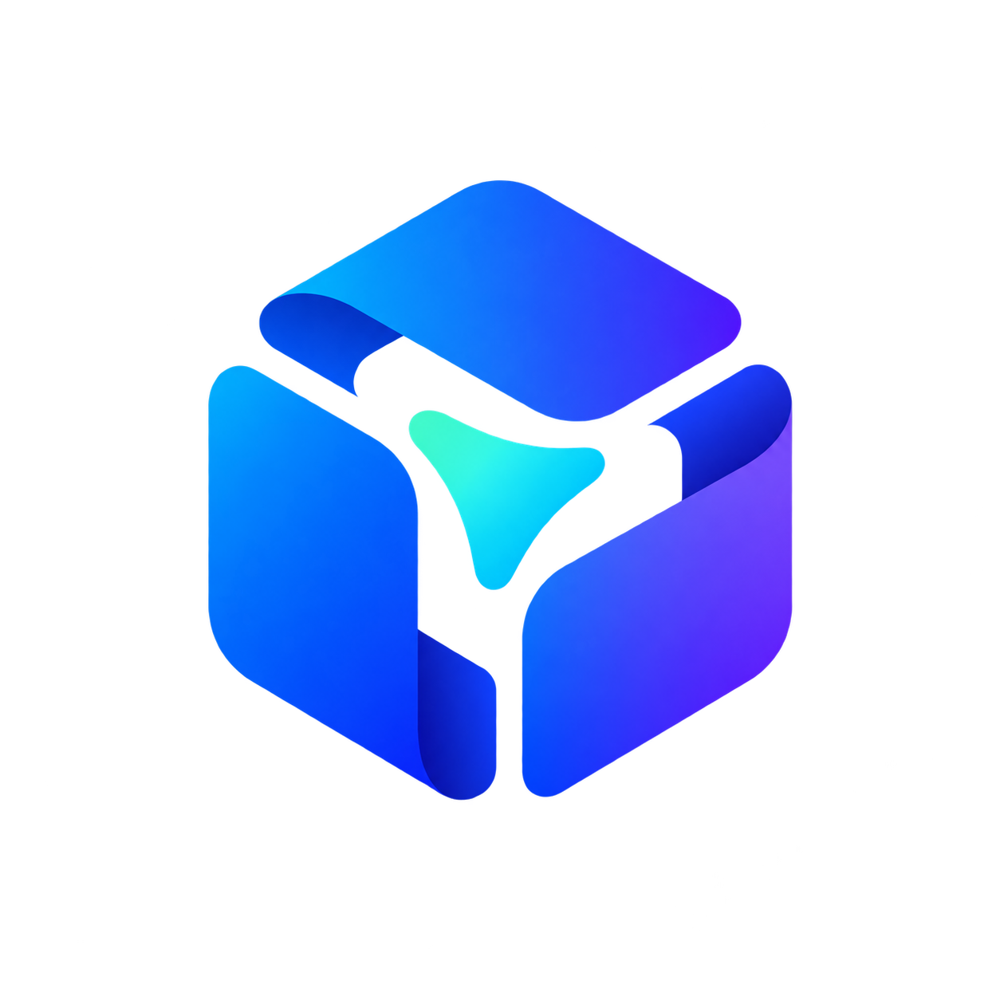
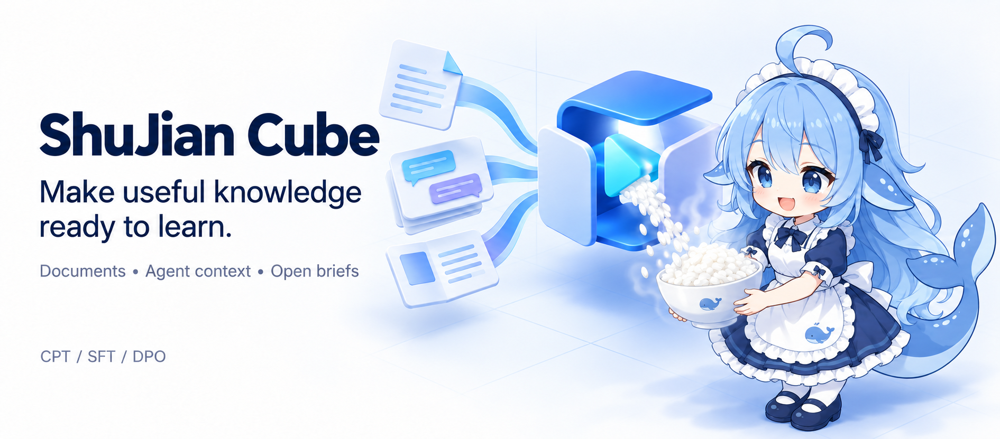
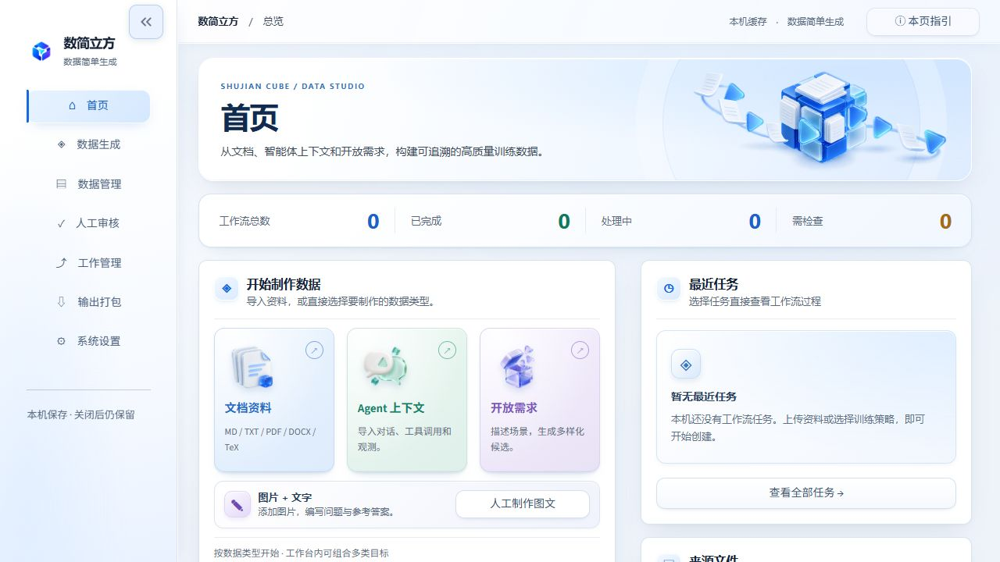
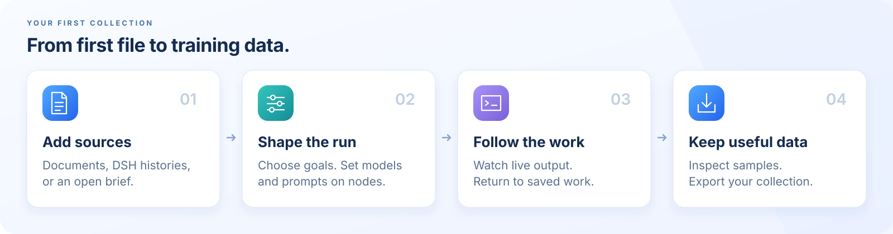
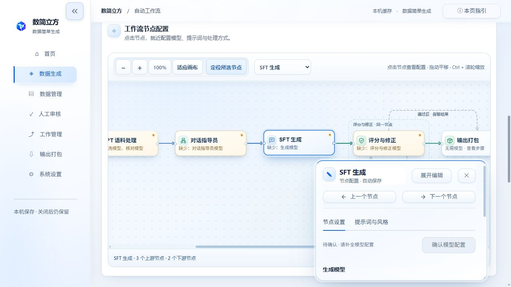
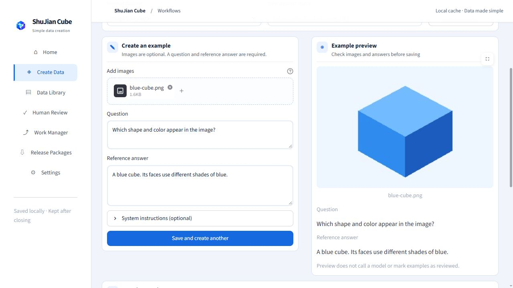
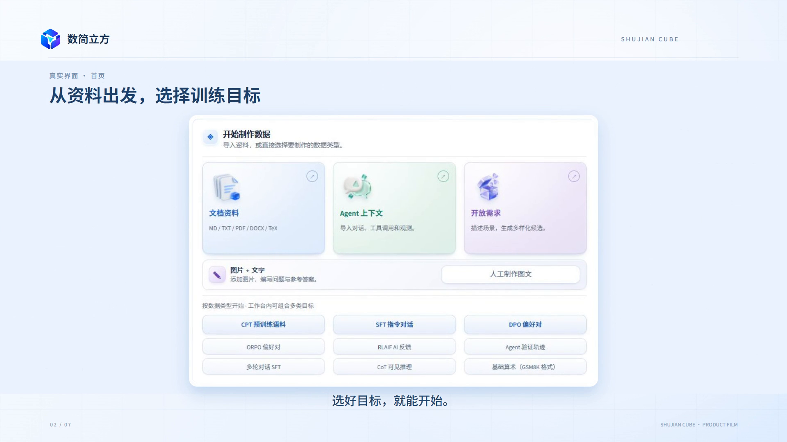

  

<h1 align="center">ShuJian Cube</h1>

<strong>Your sources. Your workflow. Your training data.</strong>

  
  
  

  
  

  <a href="#inside-the-workbench">Workbench</a> ·
  <a href="#from-source-to-sample">Workflow</a> ·
  <a href="#choose-what-you-create">Data goals</a> ·
  <a href="#get-started">Get started</a> ·
  <a href="docs/release-v0.0.1.md">Release notes</a>

  

Turn documents, agent conversations, and ideas into training examples. Follow each stage. Shape the model's style. Inspect the results before you export.

## Inside the workbench

One place to start a collection and return to saved work. Bring a paper, a set of documents, or a short brief. Your sources and tasks stay on your computer after closing the app.

  
   Actual v0.0.1 interface. English and Chinese are available.

<table>
  <tr>
    <td width="33%" valign="top"><h3>See the work</h3>
Follow the workflow. Open a node and watch text appear live. Inspect saved outputs.
</td>
    <td width="33%" valign="top"><h3>Make it yours</h3>
Choose models and edit prompts on each node. Save a personal style. Restore an earlier version.
</td>
    <td width="33%" valign="top"><h3>Keep moving</h3>
Reuse prepared sources. Work in batches. Return to saved tasks and completed requests.
</td>
  </tr>
</table>

For university teams, company projects, and personal experiments. Build domain examples, explore a new training idea, or curate a collection by hand.

## From source to sample

  

Import MD, TXT, PDF, DOCX, or TeX files. You can also use a knowledge base or describe an open task. Manual conversation-database import currently supports DSH histories.

Select a node to set its model, prompts, and limits. Add review or reasoning cleanup when the task needs it. Inspect issues and keep corrections with the saved work.

  
   Models and prompts belong to the node you are editing.

## Choose what you create

Start with one goal. Combine goals when your collection needs more than one format.

| Your goal | What you can create |
| :--- | :--- |
| **CPT** | Clean reading material for continued pretraining. |
| **SFT** | Instructions and answers. Single-turn or multi-turn conversations. |
| **DPO · ORPO** | Preferred and rejected answers for the same prompt. |
| **RLAIF** | Examples with AI feedback. |
| **CoT** | Reasoning and answers you can inspect together. |
| **Agent traces** | Conversations with recorded tool calls and observations. |
| **Arithmetic** | Template-based examples in GSM8K style. |

[Explore the nine data goals](assets/showcase/data-goals.svg) · [View the full product flow](assets/showcase/workflow-map.svg)

## Keep your own reasoning style

Keep native thinking and the answer from the same response. Create reading conversations with the source material included. Inspect the full conversation, not just its last reply.

Use the initial style or save a personal edition. DSH histories can help draft lessons from past attempts. Check the proposed rules before adopting them. Existing tasks keep the style they started with.

Style proposals are a starting point. Automatic feedback and continuous experience updates are still being completed. See the [current preview notes](docs/release-v0.0.1.md) for the scope and open work.

## Add the human touch

Some examples are easier to design yourself. Add an image. Write a question and reference answer. Preview, save, and continue. Export your examples with their original images.

  
   Manual samples are saved as unreviewed. Check them before use.

## Get started

1. **[Download v0.0.1 for Windows x64](https://github.com/tianxingstarsky/Super-LLM-distill-Gen/releases/download/v0.0.1/ShuJian-Cube-0.0.1-Windows-x64-Setup.exe).** Run the installer.
2. **Open ShuJian Cube.** Use the desktop or browser shortcut.
3. **Bring your sources.** Choose your goals. Configure the model nodes.
4. **Create, inspect, and export.** Keep useful samples and revisit issues later.

The first setup needs an internet connection. Allow about **2 GB** of free space. The installer is about **67 MB**. Connect your own model service. Manual image Q&A needs no model connection.

[Release notes](docs/release-v0.0.1.md) · [Checksums and downloads](https://github.com/tianxingstarsky/Super-LLM-distill-Gen/releases/tag/v0.0.1) · [Report an issue](https://github.com/tianxingstarsky/Super-LLM-distill-Gen/issues)

## See it in one minute

Real screens, visible workflows, and a closer look at the product. The film has Chinese narration, music, and subtitles.

  

  <a href="assets/promo/shujian-cube-promo.mp4">Watch or download the film</a> · <a href="assets/promo/captions.srt">Subtitles</a>

## Preview and notices

**v0.0.1 is an early preview.** Generated examples can be wrong. Check them before training or sharing. This release does not promise unattended million-example quality. Unreviewed samples are not approved samples.

Use sources you have permission to process. Connected model services may receive the content you submit. The installer is not code signed. Its SHA256 checksums are on the release page.

ShuJian Cube uses the [Apache License 2.0](LICENSE). See [NOTICE](NOTICE) for third-party acknowledgments.

Screenshots show the real app. Illustrations explain the product and do not show benchmark results. The DeepSeek whale girl is community-inspired fan art. There is no official DeepSeek partnership. See the [art references](assets/showcase/hero-whale-sources.md).
