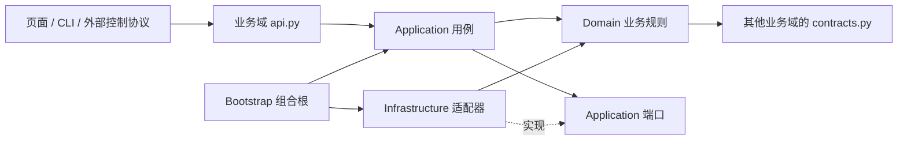

# 工程架构

数简立方采用 **DDD 模块化单体**。按业务职责组织代码，保留一个 Python 主运行时和既有持久化格式。页面和插件负责交互，应用用例协调动作，领域规则决定什么操作有效，基础设施负责磁盘、数据库和外部服务。

这次整理建立了四个实际业务边界。原有 `lib/domain/`、`lib/application/`、`lib/infrastructure/` 仍包含未迁移模块。剩余生成引擎和文档解析模块将按完整业务闭环迁移。

## 从哪里开始找代码

| 业务域 | 目录 | 当前职责 | 公开入口 |
| --- | --- | --- | --- |
| 工作流 | `lib/contexts/workflows/` | 创建约束、目标与执行图、生产策略、启动、恢复、停止、运行状态、实时输出 | `workflows/api.py` |
| 数据集 | `lib/contexts/datasets/` | 训练记录投影、格式转换、交付条件、预览、统计、归档、下载、发布版本目录 | `datasets/api.py` |
| 审核 | `lib/contexts/review/` | SFT、CPT、偏好对和 Agent 审核；候选身份、决定、来源校验和审核发布 | `review/api.py` |
| 模型 | `lib/contexts/models/` | 服务配置、能力证据、推理和并发配置、协议类型规则 | `models/api.py` |
| 组合根 | `lib/bootstrap/` | 为用例注入具体实现 | 各业务工厂 |
| 展示层 | `lib/presentation/`、`lib/webapp.py`、`lib/cli.py` | 页面、输入、展示和入口路由 | 调用应用用例 |
| 外部插件 | `plugins/` | 独立版本、安装、上游 SDK 适配和外部调度 | `dataforge.control` 协议 |

每个业务域采用同一结构：

```text
lib/contexts/<context>/
  api.py                # 面向其他用例和展示层的应用接口
  contracts.py          # 允许跨域复用的纯业务合同（需要时建立）
  domain/               # 规则、值、数据合同；无 I/O
  application/          # 用例与消费方定义的端口
  infrastructure/       # 存储、SDK、文件与进程适配
```

## 依赖方向



- Domain 不引用应用层、存储层、页面或 SDK，不创建数据库，不读写文件。
- Application 使用领域规则和自身端口，不创建存储、模型客户端或工作进程。
- 新业务域之间通过 `api.py` 或 `contracts.py` 依赖，不能导入另一域的内部适配器。
- Bootstrap 选择实现。数据集页面取得 `DatasetApplication`，审核页面取得对应审核应用。
- 兼容文件只转发到一份实现；不在新旧文件中维护两份业务规则。

## 业务一致性边界

**工作流运行**由固定配方、运行 ID、检查点和运行锁约束。恢复使用已锁定的配置与来源。生成引擎负责执行与模型请求，只读数据集用例不导入它。

**数据集版本**由原生训练文件、证据文件和清单共同确定。预览可以使用短期完整性缓存；发布和下载重新核验。失败本身不能成为可交付版本，明确提交的部分结果还必须与清单标记一致。

**审核决定**绑定候选身份和来源哈希。来源改变后，旧页面不能覆盖新内容。审核发布消费明确的审核结果，保留证据和版本记录，不修改原始产物。

**模型配置**区分人工声明与实际探测证据。工作流保存配置快照和引用，密钥、SDK 和网络实现留在基础设施。模型调度池继续执行既有共享并发约束。

CPT 重复判定保留在纯领域规则中；SQLite 索引负责存储和候选查找。两种存储复用同一判定过程，保留相似度阈值、数字保护和重复谱系规则。

## 兼容与迁移

`WorkflowApplication` 和 `FilesystemWorkflowDriver` 保留给旧调用方。生产装配已分别注入运行、数据集和审核适配器。已移动的 Domain/Application 文件保留导入别名，不再拥有实现。

`lib/infrastructure/workflow_store.py` 是既有运行目录和清单格式的文件边界。它不导入生成引擎。数据读取、统计、打包和运行查询通过它复用路径、哈希和锁语义。

`training_workflow.py` 的阶段编排、文档解析、知识库和人工增强会话仍需后续拆分。这些部分尚未成为独立业务域。具体迁移范围见 [迁移记录](architecture/migration.md)。

## 验证

```shell
python -m pytest tests/test_ddd_architecture.py tests/test_onion_architecture.py -q
python -m pytest -q --tb=short
```

架构测试递归检查新旧目录，识别相对导入、嵌套导入和兼容文件的显式重定向。独立进程测试禁止加载工作流执行引擎及模型 SDK，再实际读取、预览和统计数据。业务回归继续检查完整性、密钥阻断、审核冲突、断点及导出字段。

测试共用本地模拟服务端口，不同 pytest 进程应顺序运行。完整 Python 回归之后，再单独执行 `ui_tests`。

既有技术细节和历史验证保存在 [实现记录](architecture/implementation-notes.md)。外部插件边界见 [控制协议](external-control.md)。

本次整理的完整回归、版本补测和历史数据核验见 [验证记录](architecture/verification-2026-10-23.md)。
