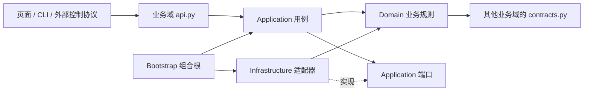

# 工程架构

数简立方采用 **DDD 模块化单体**。按业务职责组织代码，保留一个 Python 主运行时和既有持久化格式。页面和插件负责交互，应用用例协调动作，领域规则决定什么操作有效，基础设施负责磁盘、数据库和外部服务。

当前建立了五个业务边界。原有 `lib/domain/`、`lib/application/`、`lib/infrastructure/` 仍包含未迁移模块及兼容入口。代码导航见 [lib/README.md](../lib/README.md)，维护名称见 [命名与职责](architecture/naming.md)。

## 从哪里开始找代码

| 业务域 | 目录 | 当前职责 | 公开入口 |
| --- | --- | --- | --- |
| 工作流 | `lib/contexts/workflows/` | 创建约束、目标与执行图、生产策略、启动、恢复、停止、运行状态、实时输出 | `workflows/api.py` |
| 数据集 | `lib/contexts/datasets/` | 训练记录投影、格式转换、交付条件、预览、统计、归档、下载、发布版本目录 | `datasets/api.py` |
| 审核 | `lib/contexts/review/` | SFT、CPT、偏好对和 Agent 审核；候选身份、决定、来源校验和审核发布 | `review/api.py` |
| 模型 | `lib/contexts/models/` | 服务配置、能力证据、推理和并发配置、文本/JSON/工具请求策略 | `models/api.py` |
| 文档 | `lib/contexts/documents/` | 内容规范化、结构分块、TeX 保留、本地语料准备、Docling 适配 | `documents/api.py` |
| 组合根 | `lib/bootstrap/` | 为用例注入具体实现 | 各业务工厂 |
| 展示层 | `lib/presentation/`、`lib/webapp.py`、`lib/cli.py` | 页面、输入、展示和入口路由 | 调用应用用例 |
| 外部插件 | `plugins/` | 独立版本、安装、上游 SDK 适配和外部调度 | `dataforge.control` 协议 |

每个业务域采用同一结构：

```text
lib/contexts/<context>/
  api.py                # 面向其他用例和展示层的应用接口
  contracts.py          # 允许跨域复用的纯业务合同（需要时建立）
  domain/               # 规则、值、数据合同；无 I/O
  application/          # 用例与消费方定义的端口
  infrastructure/       # 存储、SDK、文件与进程适配
```

## 依赖方向



- Domain 不引用应用层、存储层、页面或 SDK，不创建数据库，不读写文件。
- Application 使用领域规则和自身端口，不创建存储、模型客户端或工作进程。
- 新业务域之间通过 `api.py` 或 `contracts.py` 依赖，不能导入另一域的内部适配器。
- Bootstrap 选择实现。数据集页面取得 `DatasetApplication`，审核页面取得对应审核应用。
- 兼容文件只转发到一份实现；不在新旧文件中维护两份业务规则。

## 业务一致性边界

**工作流运行**由固定配方、运行 ID、检查点和运行锁约束。恢复使用已锁定的配置与来源。生成引擎负责执行与模型请求，只读数据集用例不导入它。

`ExecuteWorkflowRun` 在应用层协调独占会话、快照核验、执行分支、取消和失败；`GenerateDatasetBatch` 决定普通批次的阶段顺序。`RunSessionPort` 与 `BatchRuntimePort` 隔离文件操作及节点算法。`BatchGenerationPlan` 和 `BatchOutcome` 是纯领域决定，`RecordBatch` 允许磁盘流式记录，应用层不强制转换成列表。

`GenerateMultiturnDialogue` 使用 `DialoguePort` 读取已认证资料和请求各角色，分别处理导入对话、逐轮生成和整段评审。`DialogueProgress` 只表示一次调用的临时进度；历史消息、推理字段、请求键和自然停止规则保持原合同。

`ExecuteProductionRounds` 通过 `ProductionPort` 使用收据与流式批次；`ProductionProgress` 和领域策略重建轮次及饱和停止。`GenerateProductionBatch` 决定每个窗口的节点依赖。SQLite、落盘与收据原子替换属于适配器，完成收据写入后用例才推进轮次。最终聚合复用已核验评审；旧配方允许的补充与新配方的质量优先停止继续分别执行。

`GenerateSft` 和 `GenerateDirectedSft` 管理单节点生成与证据约束；`GenerateCot` 分别处理原生推理、风格化推理和原生前缀回答；`TrimReasoning` 负责修剪及交付投影。来源读取、检查点和流式交付通过 `generation_ports.py` 接入。原生推理字段、学习者问题、历史尝试键和失败收据不因拆分而改变。

`RequestNodeModel` 管理一次节点调用，使用临时值 `NodeModelRequest` 校验意图、保持角色与捕获结果合同。`CheckpointedModelRequest` 承担冻结提示词、来源角色投影、模型绑定、日志和响应证据；组合根注入旧入口钩子，保留调用方的替换点。节点检查点重用与供应商请求重试是两层职责。

**数据集版本**由原生训练文件、证据文件和清单共同确定。预览可以使用短期完整性缓存；发布和下载重新核验。失败本身不能成为可交付版本，明确提交的部分结果还必须与清单标记一致。

**审核决定**绑定候选身份和来源哈希。来源改变后，旧页面不能覆盖新内容。审核发布消费明确的审核结果，保留证据和版本记录，不修改原始产物。

自动评审由 `ReviewCandidate` 组织有界评分与修复：相同候选复用已取得的评审，不把未知条件补成事实，不把待复核当作自动修正理由。`ReviewGeneratedCollections` 保留流式集合与 CoT/SFT 血缘；`ExecuteRepairBranch` 在任何生成请求前认证全部选中父版本。模型返回协议、来源文件、模型请求和修订发布分别由审核基础设施承担。

**模型配置**区分人工声明与实际探测证据。工作流保存配置快照和引用，密钥、SDK 和网络实现留在基础设施。模型调度池继续执行既有共享并发约束。

`ExecuteModelRequest` 决定文本请求的准入、格式降级、限次重试与取消传播；`RequestJSONResponse` 只重试不合格 JSON 或完成但无可见输出的响应；`ExecuteToolTurn` 返回完整工具决策，不执行工具。适配器实现 SDK 传输、系统时钟、共享冷却和结算。完整响应才提交证据，取消和观察器异常不转成供应商重试。models 的 API 只导出用例和端口，具体 `ChatClient` 不绕过组合根进入内层。

CPT 重复判定保留在纯领域规则中；SQLite 索引负责存储和候选查找。两种存储复用同一判定过程，保留相似度阈值、数字保护和重复谱系规则。

**文档准备**通过 `DocumentTextPort` 取得文本，`PrepareDocumentCorpus` 使用纯分块和 TeX 规则构造语料。原生格式读取与 Docling SDK 留在文档基础设施。Docling 的公式、表格、图片和阅读顺序实现集中在 `documents/infrastructure/docling/`，解析策略版本和缓存签名未因目录移动而变化。

## 兼容与迁移

`WorkflowApplication` 和 `FilesystemWorkflowDriver` 保留给旧调用方。生产装配已分别注入运行、数据集和审核适配器。已移动的 Domain/Application 文件保留导入别名，不再拥有实现。

`lib/infrastructure/workflow_store.py` 是既有运行目录和清单格式的文件边界。它不导入生成引擎。数据读取、统计、打包和运行查询通过它复用路径、哈希和锁语义。

`training_workflow.py` 中的 SFT、CoT、推理修剪和通用节点请求已交给工作流应用用例。文本、JSON 与工具请求主循环已迁入 models 应用层；`llm_client.py` 和 `model_tool_calls.py` 保留模块身份别名。CPT、偏好构造、部分质量辅助、资料库缓存、知识库和人工增强会话仍有旧实现；共享文件调度和流式传输辅助也保留现有实现。普通批次、多轮生成、生产轮次、自动评审修复与本地语料准备已分离。旧运行时钩子为调用兼容继续保留，不再承载已迁移用例的主循环。具体迁移范围见 [迁移记录](architecture/migration.md)。

## 验证

```shell
python -m pytest tests/test_ddd_architecture.py tests/test_onion_architecture.py -q
python -m pytest -q --tb=short
```

架构测试递归检查新旧目录，识别相对导入、嵌套导入和兼容文件的显式重定向。独立进程测试禁止加载工作流执行引擎及模型 SDK，再实际读取、预览和统计数据。业务回归继续检查完整性、密钥阻断、审核冲突、断点及导出字段。

执行和语料应用的独立进程测试禁止所有具体基础设施。普通批次测试使用不可展开的百万条记录替身，验证清洗、指导、SFT、偏好、CoT 与发布之间的顺序及数据传递。包内相对导入同时进行静态路径检查，避免可选 SDK 未安装时掩盖迁移错误。

多轮、生产与自动评审用例也在禁止加载基础设施与模型 SDK 的独立解释器中实际执行。内存端口测试覆盖分角色调用顺序、单轮自然停止不能冒充多轮、取消及提交失败不推进收据、重复候选不重复付费评审、修复保持用户任务与推理谱系。

SFT、CoT、节点请求和模型请求策略也在拒绝基础设施与 SDK 导入的独立解释器中通过内存端口实际执行。节点测试覆盖完整推理、学习者问题、来源证据和失败收据；请求测试覆盖共享冷却发布时机、未知费用结算、取消、格式降级与成功响应证据。

测试共用本地模拟服务端口，不同 pytest 进程应顺序运行。完整 Python 回归之后，再单独执行 `ui_tests`。

既有技术细节和历史验证保存在 [实现记录](architecture/implementation-notes.md)。外部插件边界见 [控制协议](external-control.md)。

本次整理的完整回归、版本补测和历史数据核验见 [验证记录](architecture/verification-2026-10-23.md)。

后续执行用例、文档边界与目录说明整理见 [可维护性验证](architecture/maintainability-verification-2026-10-23.md)。

多轮、生产轮次和自动评审迁移的行为对比见 [执行流程验证](architecture/pipeline-verification-2026-10-23.md)。
